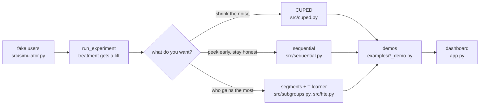

# CausalLab

An experimentation & causal inference workbench. I'm building this to get hands-on with what data science interviews at top companies actually test: designing experiments, reducing variance, and measuring real impact.

## How the pieces fit



Everything starts with the simulator: it makes fake users with a pre-period
spend level, splits them into control/treatment, and adds the true lift. Each
method builds on that same output, so the demos and the dashboard all show
the same story from different angles.

## Plan

- A/B test simulator on realistic data
- CUPED variance reduction (smaller samples, same confidence)
- Sequential testing (stop early when there's signal)
- Heterogeneous treatment effects - who benefits most
- Streamlit dashboard with a live demo

## Progress

- [x] Week 1: repo setup
- [x] Week 1: data generator + experiment simulator (`src/simulator.py`)
- [ ] Week 2: CUPED + sequential testing
- [ ] Week 3: causal ML + dashboard
- [ ] Week 4: live demo + polish

## Run

```bash
pip install -r requirements.txt
python src/simulator.py
```

The simulator makes 2000 fake users, splits them into control/treatment,
adds a true lift of 5.0 to the treatment group, and prints the measured
lift with its standard error. Example output:

```
run 1: measured lift = 6.95  (se = 1.19, true lift = 5.0)
```

## Results (real numbers from actual runs)

Every number below came from running the command shown, on 2026-10-17.
The simulator uses a fixed random seed, so these reproduce exactly.

| check | command | result |
|---|---|---|
| A/B simulator recovers a true lift of 5.0 | `python src/simulator.py` | measured lift 6.95, se 1.19, 95% CI [4.63, 9.28], p = 0.0000 |
| users per group to detect lift 5.0 (80% power, 5% level) | same run | 468 per group |
| CUPED cuts the noise | `python examples/cuped_demo.py` | se 1.19 -> 0.45, noise cut 62.4%, variance 716.5 -> 110.0 (theta = 1.00) |
| peeking 5 times: plain bar vs stricter bar | `python examples/sequential_demo.py` | plain bar flagged 17.5% of 200 experiments; stricter bar 4.0% (true lift 0) |
| T-learner recovers who benefits most | `python examples/hte_demo.py` | true avg lift 1.97, T-learner ATE 1.73, correlation(true, predicted) = 1.00 |
| overall lift hides the real story | `python examples/subgroup_demo.py` | overall 4.98 (se 0.87); heavy spenders 8.67, light spenders 0.79 (not significant, p = 0.32) |

Note: the sequential demo draws fresh random batches on every run, so its
percentages move a little — the pattern (plain bar inflates false alarms,
stricter bar stays near 5%) holds.
